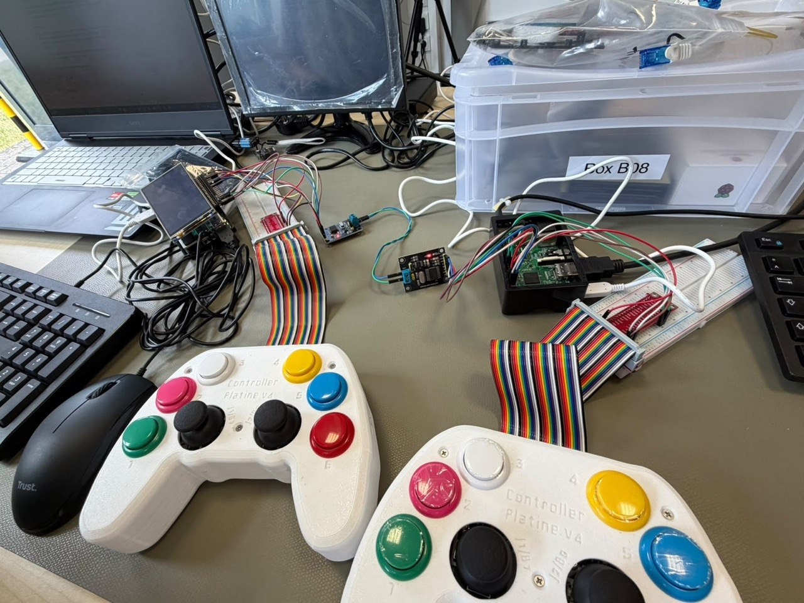
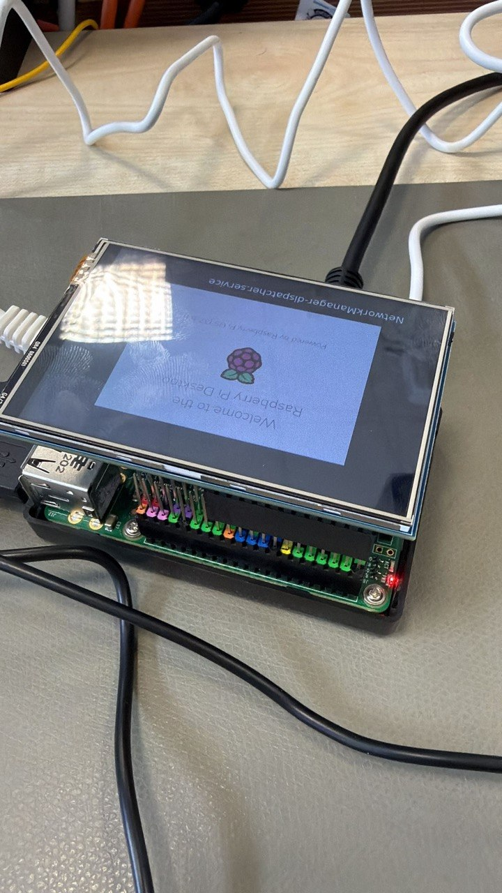

# Two Player Pac-Man over CAN

An embedded systems case study that connects two Raspberry Pi 1 Model B+ computers to run a cooperative, two player Pac-Man game. The first Pi runs the game engine and displays the game; the second Pi reads player two's controls. A direct CAN bus carries player two input and status data to the game engine.

## Project at a glance

| Item | Description |
| --- | --- |
| Project | B08 — Pac-Man via CAN |
| Platform | Two Raspberry Pi 1 Model B+ nodes |
| Main node | Runs Pygame, game logic, local player input, and the display |
| Remote node | Reads player two input and transmits it and board telemetry |
| Inter-node communication | Direct CAN bus using SBC-CAN01 / MCP2515 modules and Linux SocketCAN (`can0`) |
| Display | 480 × 320 game window; hardware architecture specifies a 3.5-inch SPI resistive touchscreen on the main node |
| Code | Python 3 source files in the supplied machine-readable archive |

## Contributors and work distribution

The following assignments are transcribed from the team's cover letter and work-distribution sheet.

| Contributor | Student ID | Work packages marked in the team distribution sheet |
| --- | --- | --- |
| **Rohit Purushottam Sorte** | `12504420` | Hardware architecture; electric circuit diagram; state-of-the-art research (shared) |
| **Mutyam Bhargav Reddy** | `12503553` | Software/function architecture; project plan (shared with Kedarnath); state-of-the-art research (shared) |
| **Balabolu Kedarnath** | `12505137` | Technical requirements; project plan (shared with Bhargav); state-of-the-art research (shared) |


## Problem and goal

The assignment is to connect two single-board computers so two players can play together in near real time, each using a controller on their own device. The main device is the central display and runs all game engine computation. The remote device has no display during play and supplies player two input over the assigned communication link.

The project applies an edge-device architecture to a familiar game: local input and game rendering happen at the main node, while player two input and remote-node status cross the CAN link.

## System architecture

```text
Player 1 controller ── ADC / GPIO ──┐
                                    v
                             Main Raspberry Pi ── SPI ── CAN module
                             game + Pygame                 │
                                    │                      │ CAN_H / CAN_L
                             SPI display                   │
                                                           │
Player 2 controller ── ADC / GPIO ── Remote Raspberry Pi ── SPI ── CAN module
                                        input + telemetry
```

The remote node sends player two control frames and periodic status values. The main node receives those frames, updates player two, and remains the authority for the maze, ghosts, score, lives, game state, and rendered screen. This is a direct device-to-device connection; the assignment does not allow a router, internet connection, PC, or phone to carry the inter-node game data.

### Main software modules

| File | Responsibility |
| --- | --- |
| `main2.py` | Pygame screens and main loop; maze, movement, collisions, ghosts, scoring; local input; CAN receive and remote telemetry; UI |
| `secondnode.py` | Remote joystick/button reads; player two input and status transmission over CAN |
| `session_manager.py` | Persistent game statistics in `gaming_data.json` |
| `board_stats.py` | Main-node CPU, RAM, uptime, storage, software, temperature, CAN link, packet errors, and latency values |
| `export_manager.py` | Combines saved gaming data and board metrics and writes a timestamped JSON file to a detected USB drive |

### CAN message flow in the supplied code

| Standard CAN ID | Sender → receiver | Payload and use | Send cadence |
| --- | --- | --- | --- |
| `0x100` | Remote Pi → main Pi | Three bytes: player two's two direction values and a status byte. Status bit 0 indicates the two-button join confirmation; bit 1 indicates a single button press. | About every 50 ms (20 Hz) |
| `0x200` | Remote Pi → main Pi | One metric ID followed by a short text value: CPU, RAM, storage, uptime, software version, connection state, temperature, or packet error count. | Metric batch about every 3 s |

The main Pi decodes these frames and updates player two and the remote-board status panel. These IDs and payload details are implementation details from the source code; verify them against the exact software version you publish. The current latency value is estimated from the difference between successive control-frame arrival times and the expected 50 ms send period. It is not a timestamped one-way measurement of the full input-to-display path, so measure that separately if reporting end-to-end latency.

### Application flow

The main program moves through these screens/states: **Main menu → name entry → lobby check → playing**. From the menu, the user can also open **gaming data**, **board statistics**, or **USB export**. The remote process runs independently: it reads the player two controls, sends input/join status, and periodically sends its board metrics. The main loop receives CAN messages, polls local input, updates the relevant game/UI state, renders the current screen, and flips the Pygame display.

## Requirements

These are the project requirements described by the assignment and requirements worksheet. 
### Functional requirements

- Support two players using two separate Raspberry Pi 1 Model B+ devices.
- Keep all game-engine processing on the main Pi; use the remote Pi as player two's input node.
- Connect one controller to each node. Do not connect both controllers to the main node.
- Obtain player names and handle player-two joining on the remote node. The brief requires player two to confirm readiness by pressing both joystick buttons together.
- Configure game settings and show the game on the main Pi.
- Exchange game input/status directly between the two devices using CAN.
- Include Pac-Man movement, maze-wall collision, pellet collection, scoring, ghost interaction, lives, and game completion.
- Store the high score and player name, session duration, total play time, last-played information, input latency, and transport delay.
- Provide a way to export measurements and game data to external storage in a human-readable format.
- Show the game, gaming data, and status information for both boards on the main display.
- Detect and handle issues such as missing hardware, invalid input, or communication problems without silently treating the system as fully operational.

### Performance and measurement targets

The requirements sheet proposes the following targets. 
| Measure | Target in requirements sheet |
| --- | --- |
| Main display refresh | At least 30 frames per second |
| CAN communication latency | Below 50 ms |
| Controller input response | Below 100 ms |
| Joystick ADC | At least 12-bit resolution and stable input |
| Runtime stability | No crashes, freezes, or unexpected restarts during normal operation |
| Remote board telemetry | CPU, RAM, storage, uptime, software version, connection, temperature, packet errors, and communication latency |

**Implementation note:** the supplied `main2.py` calls `clock.tick(20)`, so its configured loop limit is 20 frames per second. That does not meet the worksheet's 30 FPS target as written. Measure actual rendering performance and adjust the code or document this limitation before claiming the target is met. The requirements sheet also contains interface descriptions that should be checked against the actual wiring and Pi display used.

## Hardware and prerequisites

The following reflects the supplied architecture and parts overview. Confirm the final quantities and exact part revisions against your own build and the circuit diagram.

- 2 × Raspberry Pi 1 Model B+ with microSD cards and suitable power supplies.
- 2 × CAN interface modules based on MCP2515 / TJA1050, connected by CAN_H and CAN_L.
- Correct CAN bus termination and wiring for the actual bus layout; the requirements sheet specifies 120 Ω termination.
- 1 × 3.5-inch SPI resistive touchscreen connected to the main Pi.
- ADS1115 ADC module(s) for analog joystick axes, connected over I²C.
- Player controllers with joystick axes and buttons wired to the assigned GPIO pins.
- Breadboards, jumper wires, GPIO headers/adapters, and a USB storage device for export.

### Software prerequisites

The supplied Python files import these packages or hardware libraries:

- Python 3
- `pygame`
- `python-can` with the SocketCAN backend
- `psutil`
- `board` and `busio` from Blinka (`adafruit-blinka`)
- `digitalio`
- `adafruit-circuitpython-ads1x15`

Install dependencies on both Raspberry Pis as needed by the node's imports. Enable and configure I²C for the ADC, SPI for the CAN modules and display, and the Linux CAN interface (`can0`) on both nodes. Both CAN interfaces must use matching bus settings and the correct wiring. Setup values such as bitrate, chip-select pins, overlays, operating-system release, and ADC addresses depend on the actual hardware and are not fully specified by the supplied Python archive; document the values from your tested build.

## Repository layout

The supplied ZIP contains the five Python modules below. Extract them into a `Codefiles/` directory in the GitHub repository and keep the related project artifacts in clearly named folders. Do not commit a ZIP as the only way to inspect the source.

```text
.
├── README.md
├── Codefiles/
│   ├── main2.py
│   ├── secondnode.py
│   ├── board_stats.py
│   ├── export_manager.py
│   └── session_manager.py
├── docs/
│   ├── requirements.pdf
│   ├── hardware-architecture.pdf
│   ├── circuit-diagram.pdf
│   └── state-of-the-art.pdf
└── data/                 # Runtime output location, if used; do not commit personal data
```


## How the project was developed

This sequence connects the project artifacts to the supplied implementation. It describes the development flow a reader can follow; keep it aligned with the work the team actually performed.

1. **Selected the topic and defined the brief.** The course topic is B08, Pac-Man via CAN. The objective is two-player near-real-time play using two SBCs, one central display, one controller per node, and a direct CAN connection.
2. **Converted the brief into requirements.** Requirements were grouped into hardware, software, system, storage, and performance categories. Each requirement should have a unique ID, measurable acceptance criteria, source/rationale, owner, version, and test result.
3. **Designed the system architecture.** Assigned game engine, local controller, and display functions to the main Pi; assigned remote controller reading and telemetry transmission to the second Pi; selected CAN for inter-node exchange.
4. **Selected the parts and checked interfaces.** Used Raspberry Pi 1 B+, SBC-CAN01 CAN modules, joystick/ADC inputs, display, power, storage, and prototyping materials. Checked GPIO, SPI, I²C, power, and CAN wiring against the part documentation.
5. **Designed and reviewed the circuit.** Used the circuit diagram to map power, ground, SPI, I²C, GPIO, display, ADC, and CAN connections. Confirm voltage levels and pin assignments against the physical build before powering it.
6. **Built the remote input node.** `secondnode.py` reads the remote joystick and buttons, encodes control/status data, sends CAN input frames, and periodically transmits system telemetry.
7. **Built the central game node.** `main2.py` creates the Pygame interface and maze, reads player one locally, receives player two frames, and applies game updates centrally.
8. **Added session data and monitoring.** `session_manager.py` maintains JSON game records; `board_stats.py` collects local board metrics; the main interface displays game and board information.
9. **Added external export.** `export_manager.py` searches for a writable mounted USB location and exports the JSON gaming data together with board statistics.
10. **Integrated, tested, and documented.** Validate each requirement on the real hardware, record measurements and failures, refine the wiring or code, and publish the source, diagrams, setup instructions, and test evidence.

## Game rules and controls

The rules below describe the supplied `main2.py` implementation. They are project-specific and differ from the original arcade game's full rule set.

1. Player 1 and player 2 each control a Pac-Man character in the same maze.
2. The two players collect pellets from a shared maze. A normal pellet adds 10 points to the collecting player's score; a power pellet adds 50 points and makes ghosts vulnerable for a limited period.
3. Walls block movement. Movement is grid-based and attempted one tile at a time.
4. Two ghosts move randomly through available maze paths. If a player touches a ghost while it is dangerous, the team loses one shared life. There are three shared lives; a player hit while ghosts are frightened earns 200 points and the ghost returns to its start position.
5. The game ends when all pellets have been collected or the shared lives reach zero. The higher individual score determines the winner; a tie has no distinct winner in the supplied session-recording logic.
6. Player two joins from the remote node by pressing both joystick buttons together, as required by the brief. Player names are entered through the on-screen name entry flow.
7. The main menu also provides gaming-data, board-statistics, USB-export, and exit screens.

The code reads player one from an ADS1115 and GPIO on the main node, and reads player two from an ADS1115 and GPIO on the remote node. Confirm the exact physical control mapping and startup flow on your final hardware.

## Run the project

The source archive does not include a dependency lockfile, CAN setup script, operating-system image, or fully parameterized installation guide. The commands below are a starting point; adapt them to the Raspberry Pi OS release, CAN modules, pin configuration, and Python environment you actually tested.

1. Flash and boot a compatible Raspberry Pi OS image on each Pi.
2. Enable I²C and SPI and configure each CAN controller so Linux exposes `can0` on both devices.
3. Connect the two CAN modules directly using CAN_H, CAN_L, and the documented termination arrangement. Connect each controller to its own Pi; connect the display to the main Pi.
4. Install the Python and hardware-library prerequisites listed above on both devices.
5. Copy the five modules into the same application directory on each Pi. The main node needs `main2.py`, `board_stats.py`, `session_manager.py`, and `export_manager.py`; the remote node needs `secondnode.py`.
6. Bring up `can0` on both devices with matching bitrate and verify the link before starting the game. Use the CAN module and operating-system documentation for the correct configuration; do not guess the bitrate or SPI chip-select setup.
7. Start the remote input node first, then launch the main game node:

   ```bash
   # Remote Raspberry Pi
   python3 secondnode.py

   # Main Raspberry Pi, in another terminal/device
   python3 main2.py
   ```

8. Enter player names, have player two join from the remote controller, then start and play. Check the main screen's board metrics and confirm that a USB drive is mounted before exporting data.

For reproducibility, add the exact OS image, Python version, tested dependency versions, CAN bitrate, interface setup, pin mapping, wiring, and launch commands for the working build.

## Data and privacy

- `session_manager.py` writes `gaming_data.json` in the current working directory. This file contains player names, scores, session timing, and latency values.
- The session module keeps the three most recent session durations, cumulative play duration, current high score and holder, and the most recently saved input/transport latency values.
- USB export writes a timestamped `game_log_YYYY-MM-DD_HH-mm-ss.json` file containing gaming data and statistics for both boards.
- Do not commit real player names, session logs, credentials, Wi-Fi details, or other personal data. Add local data files to `.gitignore` and include a sanitized example JSON file if helpful.

## Verification and known limitations


Before release, create a test table with requirement ID, setup, procedure, expected result, measured result, pass/fail, and evidence. At minimum test:

- Game display resolution and frame rate on the actual touchscreen.
- Local and remote joystick directions, button actions, name entry, and player-two join confirmation.
- CAN communication on the wired bus, measured end-to-end transport delay, disconnect behavior, and recovery.
- Maze blocking, pellet and power-pellet scoring, ghost collisions, shared lives, win/loss behavior, and tie handling.
- Session data persistence after restart, USB detection/export, JSON readability, and missing-drive error feedback.
- CPU, RAM, storage, uptime, temperature, connection status, packet errors, and telemetry updates on both nodes.
- Stability during a continuous gameplay session.

Known implementation/documentation items to resolve or state honestly:

- The main game loop is limited by `clock.tick(20)`, while the requirements worksheet asks for 30 FPS or more.
- The saved `last_time_played` field is currently a session duration in minutes, not a calendar timestamp. If the requirement means the date/time of the last session, add a separate timestamp field and verify it persists.
- The session record is saved when a session ends through the implemented completion/life-loss paths. Verify tie games and abrupt shutdowns, because they may not produce a completed session record.
- The CAN input cadence is 20 Hz, but the current arrival-interval estimate is not a direct one-way latency measurement. Add a sequence number or sender timestamp and a defined clock/round-trip method if the project must demonstrate transport delay quantitatively.
- Many requirement rows are marked under review/prototype stage; the provided files do not establish measured pass results.
- The hardware architecture text and requirements sheet describe some interfaces inconsistently. Check the displayed panel, SPI/DSI wording, ADC bus, and exact GPIO/SPI chip-select wiring against the actual Raspberry Pi 1 B+ build.
- The project brief says player names and error handling belong on the individual nodes. Confirm that the final behavior satisfies this, since the game display and central game logic are on the main node.
- CAN bitrate, timeout/recovery behavior, and concrete fault-injection evidence should be documented for the tested setup.

## What this project demonstrates

- Splitting a real-time application across two edge devices.
- Designing local input, ADC/GPIO integration, and a CAN-based remote input path.
- Keeping authoritative game logic on a central node while accepting remote player actions.
- Building a Pygame state-driven interface for game play, session records, telemetry, and export.
- Translating a course brief into measurable requirements and a hardware/software test plan.

## Credits

- **Course topic:** B08 — Pacman via CAN, Case Study Edge Device Architecture.
- **Authors/team:** Rohit Purushottam Sorte (`12504420`), Mutyam Bhargav Reddy (`12503553`), and Balabolu Kedarnath (`12505137`)
- **Course/institution:** TH DEGGENDORF CHAM CAMPUS
- **License:** All rights are reserved by **Group B08**
  



