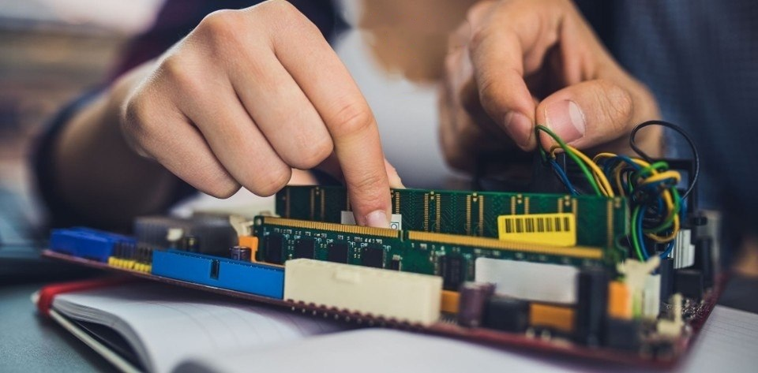

# 🎮 Two-Player Pac-Man over CAN

   

For our Case Study Edge Device Architecture project, we connected two Raspberry Pi 1 Model B+ computers to run a two-player Pac-Man game. The main Pi runs the game and display. The second Pi reads player two's controller and sends input to the main Pi over a direct CAN connection.

The players share the maze and three lives, but each has an individual score. The project brings together embedded hardware, controller input, CAN messaging, a Pygame interface, board monitoring, session records, and USB data export.

## 📌 Project at a glance

| | |
| --- | --- |
| Course | Case Study Edge Device Architecture |
| Group / topic | B08 — Pacman via CAN |
| Study program | Artificial Intelligence for Smart Sensors and Actuators |
| Institution | TH Deggendorf, Campus Cham |
| Grade | 1.0 on the German grading scale |
| Instructor | Prof. Dr. Matthias Górka |
| Boards | 2 × Raspberry Pi 1 Model B+ |
| Display | 3.5-inch resistive touchscreen, 480 × 320, SPI |
| Inter-board link | Direct CAN using SBC-CAN01 modules with MCP2515 controllers and TJA1050 transceivers |
| Software | Python 3 and Pygame |

## 👥 Team and work distribution

The task assignments below follow the team's cover letter and work-distribution sheet.

| Team member | Student ID | Assigned work |
| --- | --- | --- |
| **Rohit Purushottam Sorte** | `12504420` | Hardware architecture and electric circuit diagram; state-of-the-art research with the team |
| **Mutyam Bhargav Reddy** | `12503553` | Software/function architecture; project plan with Kedarnath; state-of-the-art research with the team |
| **Balabolu Kedarnath** | `12505137` | Technical requirements; project plan with Bhargav; state-of-the-art research with the team |

The work-distribution sheet does not assign coding, simulation, or testing to individual members, so those tasks are not attributed to a particular person here.

## 🧭 Project goal

The assignment was to let two players use controllers connected to separate single-board computers and play together in near real time. The first Raspberry Pi acts as the central game computer: it runs the game logic, accepts player one's input, and drives the display. The second Pi has no display during play and provides player two's input.

The two boards communicate directly over CAN. A router, internet connection, PC, or phone is not part of the game link. Before a game begins, player two confirms joining by pressing both controller switches together.

## 📋 Assignment requirements

The project brief and requirements sheet call for:

- Two Raspberry Pi 1 Model B+ boards, with one controller attached to each board.
- The main Pi to run the game engine, display, game settings, and central game state.
- The remote Pi to read player two's controls and handle its local input processing.
- Player names, a player-two join confirmation, and handling for communication or input problems.
- Direct CAN communication between the boards.
- Pac-Man movement, maze-wall collision, pellets, scoring, ghosts, lives, and clear game-ending states.
- Persistent high score, player name, session and overall play time, last-played information, and latency data.
- Human-readable export of game measurements and session data to external storage.
- Main-screen display of the game and status information for both boards, including CPU, RAM, uptime, storage, software version, connection, temperature, packet errors, and communication latency.

The requirements sheet treats several of these as prototype-stage requirements. The implementation details and verification status are described below.

## 🏗️ System architecture

```text
Player 1 controller → ADS1115 / GPIO → Main Raspberry Pi → SPI display
                                            ↕ SPI
                                        CAN module
                                            ↕ CAN_H / CAN_L
                                        CAN module
                                            ↕ SPI
Player 2 controller → ADS1115 / GPIO → Remote Raspberry Pi
```

The main Pi owns the maze, player positions, pellets, ghost movement, scores, lives, and game state. The remote Pi reads player two's controller and sends control and status messages. It also reports system metrics that appear in the main node's status display.

### Software modules

| File | Role in the project |
| --- | --- |
| `main2.py` | Runs the Pygame screens and game loop; reads player one; receives CAN input and telemetry; updates the maze, movement, ghosts, scores, collisions, and lives. |
| `secondnode.py` | Reads player two's joystick and switches, sends input and join status over CAN, and reports remote-board metrics. |
| `session_manager.py` | Reads and writes game-session statistics in `gaming_data.json`. |
| `board_stats.py` | Collects CPU, RAM, uptime, disk use, software version, CAN status, temperature, packet errors, and a latency estimate for the main Pi. |
| `export_manager.py` | Finds a writable USB mount and exports game data and board statistics as JSON. |

The main application moves through a menu, name-entry screen, lobby check, and game. The menu also opens gaming data, board statistics, USB export, and exit screens. After player two's join confirmation arrives, the program waits 1.5 seconds, starts the session timer, and begins play.

## 🧰 Hardware

The architecture and parts overview specify the following setup:

| Component | Quantity | Purpose |
| --- | ---: | --- |
| Raspberry Pi 1 Model B+ | 2 | Main game/display node and remote input node |
| SBC-CAN01 CAN module | 2 | Connects each Pi to CAN; uses an MCP2515 controller and TJA1050 transceiver |
| 3.5-inch resistive touchscreen | 1 | Main display; 480 × 320 resolution and SPI interface |
| ADS1115 ADC | 2 | Converts analog joystick readings over I²C; 16-bit, four-channel converter |
| Two-axis joystick modules with switch | 4 | Parts overview allocates two joystick modules to each controller |
| Arcade buttons | 12 | Six buttons per controller in the parts overview |
| 8 GB Class 10 microSDHC card | 2 | Operating system, application, and local data storage |
| Micro-USB power supply | 2 | 5.1 V / 2.5 A per Pi, as specified in the hardware architecture |
| Breadboard | 2 | Prototyping controller and interface connections |
| GPIO ribbon-to-pin converter | 2 | Connects controller wiring to the Pi GPIO header |
| GPIO header expansion | 1 | GPIO extension/adapter |
| Jumper-wire sets | 2 | Prototyping and module connections |
| SD card reader | 1 | Flashing or accessing microSD cards |
| USB storage | 1 | Destination for exported data |

The display and CAN module share SPI signals on the main Pi, so they need separate chip-select handling. The hardware architecture discusses using a software-defined chip select on SPI0 or moving CAN to SPI1, as well as assigning a GPIO pin to the CAN interrupt. CAN_H and CAN_L connect the two modules, with 120 Ω termination specified in the requirements sheet.

The design describes two joystick modules and six arcade buttons per controller. The supplied Python code reads one ADS1115 X/Y pair on each Pi and a small number of switch pins. The hardware description and software input mapping therefore do not describe exactly the same controller configuration.

## 🔄 CAN message flow

Both programs use the Linux SocketCAN interface named `can0`.

| CAN ID | Direction | Data | Timing in code |
| --- | --- | --- | --- |
| `0x100` | Remote Pi → main Pi | Three bytes: two joystick direction values and a status byte. Status bit 0 indicates both switches are pressed for joining; bit 1 indicates one switch is pressed. | About every 50 ms (20 Hz) |
| `0x200` | Remote Pi → main Pi | Metric ID followed by up to seven text bytes. IDs 1–8 represent CPU, RAM, disk use, uptime, software version, connection status, temperature, and packet errors. | About every 3 seconds |

The main Pi uses these messages to move player two and update the remote-board status display. Its latency value is estimated from the spacing between incoming `0x100` frames and their expected 50 ms interval. This is not a direct measurement from joystick movement to screen response.

Other interfaces are GPIO for digital switches, I²C for the ADS1115, SPI for the CAN modules and touchscreen, microSD for local storage, and USB for data export.

## 🧩 How the project came together

1. **We defined the goal.** The B08 assignment called for two players on separate Raspberry Pi boards, one central game display, and direct communication over CAN.
2. **We organized the requirements.** The requirements sheet covers hardware, software, system behavior, storage, and performance, with IDs such as `HW-001`, `SW-001`, `SYS-001`, `ST-001`, and `PE-001`.
3. **We researched the topic and planned the work.** The team prepared a state-of-the-art overview and divided the architecture, requirements, circuit, software-function, and planning documents as shown in the work-distribution table.
4. **We designed the hardware.** The architecture separates the main game/display node from the remote controller node and identifies the Pi, CAN modules, display, ADCs, controller inputs, power, and storage.
5. **We documented the circuit.** The electric circuit diagram shows the power, ground, GPIO, I²C, SPI, display, ADC, and CAN connections.
6. **We separated the software roles.** The main game, remote input, session manager, board-statistics collector, and USB exporter are implemented in five Python modules.
7. **We implemented remote input and telemetry.** `secondnode.py` reads player two's controls and sends input/status frames and board metrics over CAN.
8. **We implemented the central game.** `main2.py` reads player one locally, receives player two's CAN messages, updates the maze and game state, and renders the screen.
9. **We added records and export.** The session manager stores gameplay statistics; the monitoring and export modules collect system information and save a combined JSON file to USB.
10. **We integrated the two nodes.** The programs expect `can0` on both Raspberry Pis, with matching CAN settings and each controller attached to its own board.

The project files do not include a completed test report, so measured verification results are not stated here.

## 🕹️ Game rules

These rules describe the implementation in `main2.py`:

1. Each player controls a character in the same 20-column by 11-row maze.
2. Players move one tile at a time; walls block movement.
3. A normal pellet gives 10 points to the player who collects it.
4. A power pellet gives 50 points and temporarily frightens the ghosts.
5. Two ghosts move randomly through open maze cells.
6. Touching a dangerous ghost costs the team one of its three shared lives. If a life remains, the player positions reset. Touching a frightened ghost sends it back to its starting position and gives the player 200 points.
7. The game ends when all pellets are collected or the shared lives reach zero.
8. If the scores differ, the higher-scoring player is named the winner. The supplied session logic does not set a distinct winner for a tie.

## 📊 Data and export

`session_manager.py` saves `gaming_data.json` in the application's current working directory. It stores the high score and holder, the three latest session durations, total play duration, the latest session duration, and latency values.

The main Pi gathers CPU, RAM, uptime, disk use, operating-system release, CAN status, temperature, packet errors, and its latency estimate. The remote Pi sends similar board metrics to the main Pi. When a writable USB drive is mounted, `export_manager.py` writes the game data and board metrics to a timestamped file named `game_log_YYYY-MM-DD_HH-mm-ss.json`.

In the current code, `last_time_played` is a session duration in minutes, not a calendar date and time. Game records can contain player names, so runtime data should not be committed to a public repository.

## 🖥️ Running the programs

The code imports `pygame`, `python-can` with SocketCAN, `psutil`, Blinka (`board`, `busio`, and `digitalio`), and `adafruit-circuitpython-ads1x15`. I²C and SPI must be enabled, and both CAN modules must be configured as `can0` with matching bus settings.

Start the remote controller program first:

```bash
python3 secondnode.py
```

Then start the game on the main Raspberry Pi:

```bash
python3 main2.py
```

The project files do not specify tested operating-system, Python, or package versions, the CAN bitrate, complete overlay commands, or a definitive pin map. The exact settings depend on the Raspberry Pi OS and hardware revisions used.

## ✅ Requirements and implementation status

The requirements sheet sets the following performance goals. The measurements below distinguish those goals from what can be confirmed in the supplied code and documents.

| Area | Requirement target | Project status in supplied files |
| --- | --- | --- |
| Display | At least 30 FPS | `main2.py` calls `clock.tick(20)`, so the game loop is capped at 20 FPS. The code as supplied does not meet the 30 FPS target. |
| CAN communication | Below 50 ms latency, with no packet loss during gameplay | CAN messaging is implemented, but no latency or packet-loss test report was supplied. |
| Controller response | Below 100 ms | Remote input is sent every 50 ms; no end-to-end response measurement was supplied. |
| ADC | At least 12-bit resolution and stable input | The design specifies a 16-bit ADS1115; no noise or stability measurement was supplied. |
| Runtime stability | No crashes, freezes, or unexpected restarts | No long-duration test report was supplied. |
| Board monitoring | CPU, RAM, storage, uptime, software, connection, temperature, packet errors, and latency | Collection and display code is present; no accuracy-validation report was supplied. |

Many requirements are marked under review or prototype stage in the requirements sheet. The supplied source shows the intended features, but it does not include a completed test report proving that every target passed on the assembled hardware.


## 📁 Source files

The machine-readable archive contains these five Python files:

```text
Codefiles/
├── main2.py
├── secondnode.py
├── board_stats.py
├── export_manager.py
└── session_manager.py
```

The project materials also include the requirements sheet, hardware architecture, electric circuit diagram, state-of-the-art document, parts overview, and parts-description archives. The source code was delivered in `26_SS_B08_Machine_Readable_Files_v02.zip`.

## 📚 Attribution and project identity

The course instructions require code sources to be referenced and prohibit unattributed copying. They also require AI-assisted content to be disclosed. This README was edited with AI assistance from the project materials; that assistance should be recorded in the format required by the course. The note applies to the README wording and makes no claim about how the supplied Python code was written.

This is an educational Pac-Man case study and is not affiliated with or endorsed by the Pac-Man rights holders. Third-party code, libraries, datasheets, diagrams, photographs, artwork, sounds, and course materials remain subject to their respective sources and rights.

## 🏅 Result and team

I have received a grade of **1.0** for the case study, under the supervision of **Prof. Dr. Matthias Górka**.

- Rohit Purushottam Sorte — `12504420`
- Mutyam Bhargav Reddy — `12503553`
- Balabolu Kedarnath — `12505137`

**License:** All rights reserved by Group B08. 


